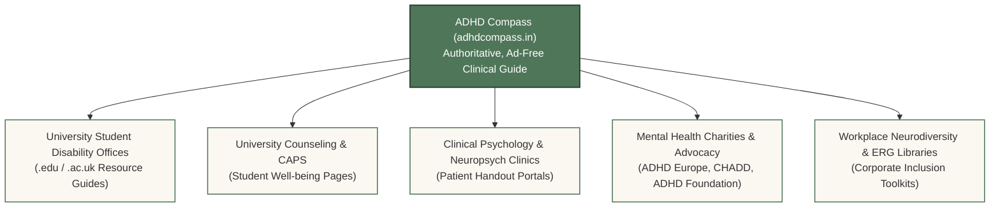
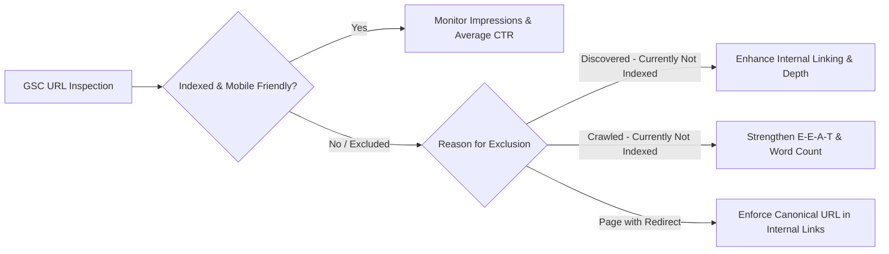
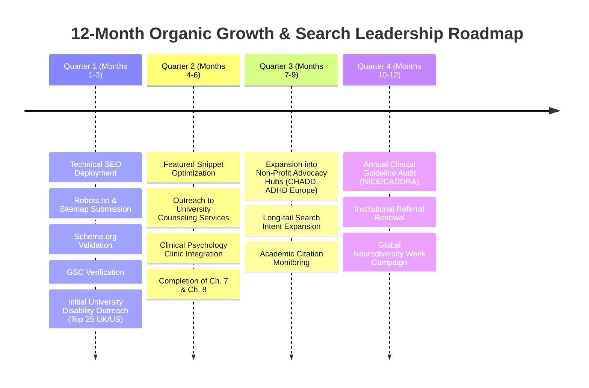

# ADHD Compass (https://adhdcompass.in) — Comprehensive Organic Growth & Technical SEO Plan

**Document Version:** 1.0.0  
**Effective Date:** October 2026  
**Author:** Agent 7 — Organic Growth & Technical SEO Specialist  
**Target Domain:** `https://adhdcompass.in`  
**Target Audience:** Adults with ADHD, university students, clinicians, disability coordinators, educators, and researchers  
**Core Mission:** Build sustainable, compounding, highly ethical organic visibility for ADHD Compass without link buying, social media spam, or AI-generated content farms.

---

## Table of Contents

1. [Executive Summary & Strategic Growth Philosophy](#1-executive-summary--strategic-growth-philosophy)
2. [Google E-E-A-T & YMYL Compliance Strategy](#2-google-e-e-a-t--ymyl-compliance-strategy)
3. [Technical SEO Architecture & Implemented Wins](#3-technical-seo-architecture--implemented-wins)
   - [3.1 Title Templates & Meta Descriptions](#31-title-templates--meta-descriptions)
   - [3.2 Canonical Tag & Normalization Rules](#32-canonical-tag--normalization-rules)
   - [3.3 Production robots.txt Architecture](#33-production-robotstxt-architecture)
   - [3.4 XML Sitemap Strategy](#34-xml-sitemap-strategy)
   - [3.5 Schema.org JSON-LD Structured Data Implementation](#35-schemaorg-json-ld-structured-data-implementation)
   - [3.6 SPA Metadata React Component (`SEO.tsx`)](#36-spa-metadata-react-component-seotsx)
4. [Search-Intent Mapping for High-Intent Queries](#4-search-intent-mapping-for-high-intent-queries)
   - [4.1 Granular Search Intent Matrix](#41-granular-search-intent-matrix)
   - [4.2 On-Page Content Engineering & SERP Snippet Optimization](#42-on-page-content-engineering--serp-snippet-optimization)
5. [High-Quality, Ethical Organic Referral Strategy](#5-high-quality-ethical-organic-referral-strategy)
   - [5.1 Priority Referral Categories](#51-priority-referral-categories)
   - [5.2 Target Institutional Segments](#52-target-institutional-segments)
   - [5.3 Production Outreach Playbook & Email Templates](#53-production-outreach-playbook--email-templates)
   - [5.4 Outreach Cadence & Relationship Stewardship](#54-outreach-cadence--relationship-stewardship)
6. [Google Search Console & Webmaster Action Plan](#6-google-search-console--webmaster-action-plan)
   - [6.1 Verification & Initial Configuration](#61-verification--initial-configuration)
   - [6.2 Crawl Budget & Indexation Management](#62-crawl-budget--indexation-management)
   - [6.3 Structured Data & Rich Result Validation](#63-structured-data--rich-result-validation)
7. [Core Web Vitals & Technical Performance Baselines](#7-core-web-vitals--technical-performance-baselines)
   - [7.1 Performance Metrics & Target Thresholds](#71-performance-metrics--target-thresholds)
   - [7.2 Remediation of Scaffolding Bloat & Bundle Optimization](#72-remediation-of-scaffolding-bloat--bundle-optimization)
8. [Measurement, Metrics & 12-Month Execution Roadmap](#8-measurement-metrics--12-month-execution-roadmap)

---

## 1. Executive Summary & Strategic Growth Philosophy

ADHD Compass is an independent, non-commercial educational project created to translate the neuroscience, clinical pharmacology, and lived experiences of ADHD into clear, compassionate, and empowering insights. In contrast to commercial ADHD platforms that monetize user data, sell telehealth subscriptions, or operate high-churn affiliate funnels, ADHD Compass is strictly privacy-first:
- **Zero user tracking / zero behavioral ad cookies**
- **Zero sponsored medication placements or affiliate links**
- **Zero gatekeeping or login walls**
- **Evidence-based clinical rigor** cross-referenced with NICE NG87, DSM-5-TR, AAP, CADDRA, and peer-reviewed Lancet Psychiatry meta-analyses.

### The Organic Opportunity
In Google's post-2024 search ecosystem (characterized by the **Helpful Content System**, March 2024 Core Update, and ongoing Search Generative Experience / AI Overviews rollouts), search engines aggressively penalize:
1. Low-effort AI content farm articles churned out solely for ad impressions.
2. Commercially conflicted affiliate review pages with deceptive medical claims.
3. Slow, bloated, pop-up-ridden medical portals.

Search engines and users actively reward **deep, original, human-crafted educational resources** with high information gain, transparent sourcing, accessible design, and strong institutional trust. By establishing best-in-class technical SEO hygiene and conducting ethical, value-led outreach to universities, clinics, and non-profit advocacy organizations, ADHD Compass is poised to capture high-intent search traffic and become the global authoritative compass for ADHD education.

---

## 2. Google E-E-A-T & YMYL Compliance Strategy

ADHD is categorized by Google Quality Rater Guidelines as a **Your Money or Your Life (YMYL)** topic under Health and Mental Health. Pages addressing YMYL topics require the highest standards of **E-E-A-T** (Experience, Expertise, Authoritativeness, and Trustworthiness).

| E-E-A-T Pillar | Strategy & Implementation on ADHD Compass |
| :--- | :--- |
| **Experience** | Validates authentic neurodivergent lived experiences (e.g., emotional dysregulation, rejection sensitivity, task paralysis, sensory overload) without clinical pathologization. Detailed breakdown of daily friction points in Chapter 2 (*Why It Feels Like This*). |
| **Expertise** | Grounded in peer-reviewed neuroscience: prefrontal cortex dysfunction (Arnsten), default mode network dysregulation (Castellanos & Proal), dopamine/norepinephrine transporter dynamics (DAT/NET), and exact pharmacological titration mechanisms. |
| **Authoritativeness** | Direct citations to international clinical guidelines (NICE NG87, CADDRA 2020, AAP 2019) and meta-analyses (Cortese et al., Lancet Psychiatry 2018; Faraone et al., World Federation of ADHD Consensus Statement 2021). |
| **Trustworthiness** | Explicit medical disclaimers, clear editorial independence statement, open-source codebase, no pharmaceutical sponsorship, zero commercial data gathering, and verifiable author/source bibliographies on substantive pages. |

---

## 3. Technical SEO Architecture & Implemented Wins

### 3.1 Title Templates & Meta Descriptions

A standardized, character-calibrated title tag and meta description hierarchy has been established across all routes. Every title includes primary high-intent keywords, clear branding, and remains under 60 characters to prevent SERP truncation. Every meta description is kept between 140–158 characters with an active, empathetic hook.

| Route | Page Name | Optimized Document Title | Character Count | Meta Description |
| :--- | :--- | :--- | :---: | :--- |
| `/` | Homepage / Compass | `ADHD Compass \| Understanding Your Brain` | 41 | An independent, evidence-based, compassionate guide translating ADHD neuroscience, executive dysfunction, diagnosis pathways, and treatments. |
| `/about` | About & Methodology | `About ADHD Compass \| Evidence Standards & Sources` | 51 | ADHD Compass is an independent educational initiative grounded in peer-reviewed neuroscience, NICE clinical guidelines, and lived experiences. |
| `/chapter/welcome` | Ch. 1: Welcome | `Welcome to ADHD Compass: Navigating Your ADHD Journey` | 54 | A gentle, grounding introduction for adults navigating ADHD. Learn how to pace your reading and explore evidence-based chapters without overwhelm. |
| `/chapter/why-feels` | Ch. 2: Lived Experiences | `Why It Feels Like This: Lived ADHD Experiences` | 47 | Deconstruct why ADHD feels like overwhelm, task paralysis, sensory overload, time blindness, and rejection sensitivity with compassionate science. |
| `/chapter/what-is` | Ch. 3: Clinical Definition | `What is ADHD? Clinical Definitions, Presentations & Myths` | 58 | Understand DSM-5-TR ADHD presentations: inattentive, hyperactive, and combined. Debunk pervasive myths regarding dopamine deficiency and willpower. |
| `/chapter/brain` | Ch. 4: Neuroscience | `Meet Your Brain: ADHD Neurobiology & Neural Networks` | 53 | An interactive neuroanatomical guide to the ADHD brain: prefrontal cortex, default mode network (DMN), salience network, and dopamine signaling. |
| `/chapter/brain/executive-functions` | Executive Functions | `ADHD Executive Dysfunction: Working Memory & Control` | 53 | In-depth clinical guide to executive functions in ADHD: working memory capacity, response inhibition, cognitive flexibility, and Barkley's model. |
| `/chapter/what-helps` | Ch. 5: Strategies | `What Actually Helps: Evidence-Based ADHD Strategies` | 52 | Practical, research-backed interventions for ADHD: cognitive behavioral strategies, externalizing working memory, body doubling, and lifestyle. |
| `/chapter/medication` | Ch. 6: Medication Guide | `ADHD Medication Guide: Stimulants, Non-Stimulants & Action` | 59 | Comprehensive clinical guide to ADHD medications: methylphenidate vs amphetamines, atomoxetine, alpha-2 agonists, titration kinetics, and side effects. |
| `/chapter/getting-diagnosed` | Ch. 7: Diagnosis | `Getting Diagnosed: Adult ADHD Assessment Pathways` | 50 | A step-by-step roadmap to seeking an adult ADHD diagnosis: clinical interviews (DIVA-5, CAARS), psychiatric evaluation, and preparation checklists. |
| `/chapter/accommodations` | Ch. 8: Accommodations | `ADHD Accommodations: Educational & Workplace Rights` | 51 | Legal and practical guide to ADHD accommodations: university disability support, exam adjustments, workplace adjustments, and disclosure strategies. |

---

### 3.2 Canonical Tag & Normalization Rules

To prevent search engines from splitting page rank across multiple URL variations:
1. **Canonical Tag Generation:** Every route dynamically outputs `<link rel="canonical" href="https://adhdcompass.in{route}" />`.
2. **Trailing Slash Normalization:** All canonicals omit trailing slashes (except root `/`), avoiding duplicate indexation (`/chapter/medication` vs `/chapter/medication/`).
3. **Query Parameter Stripping:** Any campaign or analytics parameters (e.g., `?utm_source=...`, `?ref=...`) are excluded from canonical URLs.
4. **HTTPS Enforcement:** Protocol is strictly enforced to `https://`.

---

### 3.3 Production `robots.txt` Architecture

The production `robots.txt` has been deployed directly to `client/public/robots.txt`:

```txt
# ==============================================================================
# ADHD Compass (https://adhdcompass.in) - robots.txt
# Evidence-based, compassionate guide to ADHD neuroscience, treatments & lived experience.
# ==============================================================================

User-agent: *
Allow: /
Allow: /about
Allow: /chapter/
Allow: /resources/
Allow: /assets/

# Disallow internal debug runtimes, sandbox telemetry, and storage proxy endpoints
Disallow: /__manus__/
Disallow: /manus-storage/
Disallow: /.manus-logs/

# Disallow internal 404 error page from search engine indexation
Disallow: /404

# Host declaration
Host: https://adhdcompass.in

# Canonical XML Sitemap
Sitemap: https://adhdcompass.in/sitemap.xml
```

**Key SEO Features:**
- Whitelists all educational content and chapter routes for maximum crawl discoverability.
- Restricts internal development and sandbox artifacts (`/__manus__/`, `/manus-storage/`), preserving crawl budget for genuine content.
- Explicitly points crawlers to the authoritative XML sitemap location.

---

### 3.4 XML Sitemap Strategy

The canonical sitemap has been authored and placed at `client/public/sitemap.xml`:
- Includes all 8 primary chapters, `/`, `/about`, the `executive-functions` sub-chapter, and upcoming roadmap chapters.
- Prioritizes substantive clinical chapters (`/chapter/medication`, `/chapter/brain`, `/chapter/what-is`, `/chapter/what-helps`) at `0.9`–`1.0`.
- Places `/about` at `0.8` to ensure search engine algorithms evaluate E-E-A-T credentials and editorial sources.
- Uses standard ISO 8601 timestamps (`2026-10-17`) and valid schema definitions.

---

### 3.5 Schema.org JSON-LD Structured Data Implementation

Three primary JSON-LD schema models have been engineered and deployed to facilitate Google Rich Results, Knowledge Panels, and rich snippet displays:

#### 1. `EducationalOrganization` Schema (Deployed to `index.html` & `schema.json`)
Establishes domain authority, non-commercial educational identity, and thematic knowledge domains:
```json
{
  "@context": "https://schema.org",
  "@type": "EducationalOrganization",
  "@id": "https://adhdcompass.in/#organization",
  "name": "ADHD Compass",
  "alternateName": "ADHD Compass Educational Initiative",
  "url": "https://adhdcompass.in",
  "logo": "https://adhdcompass.in/hero-reference.png",
  "description": "An independent, evidence-based, compassionate educational compass translating ADHD neurobiology, pharmacology, and lived experiences into accessible insights.",
  "publishingPrinciples": "https://adhdcompass.in/about#sources",
  "knowsAbout": [
    "Attention Deficit Hyperactivity Disorder (ADHD)",
    "Executive Functioning and Executive Dysfunction",
    "Prefrontal Cortex Neurobiology",
    "Dopamine and Norepinephrine Transporter Mechanisms",
    "ADHD Medication: Stimulant and Non-Stimulant Pharmacology",
    "Adult ADHD Diagnosis and Assessment Pathways",
    "Academic and Workplace Accommodations"
  ]
}
```

#### 2. `MedicalWebPage` Schema (Implemented on Clinical Chapters)
Injected dynamically on `/chapter/medication`, `/chapter/brain`, `/chapter/what-is`, and `/chapter/brain/executive-functions`:
```json
{
  "@context": "https://schema.org",
  "@type": "MedicalWebPage",
  "@id": "https://adhdcompass.in/chapter/medication#medicalwebpage",
  "url": "https://adhdcompass.in/chapter/medication",
  "name": "ADHD Medication Guide: Stimulants, Non-Stimulants & Mechanisms | ADHD Compass",
  "about": {
    "@type": "MedicalCondition",
    "name": "Attention Deficit Hyperactivity Disorder",
    "alternateName": ["ADHD", "ADD"],
    "code": {
      "@type": "MedicalCode",
      "code": "F90",
      "codingSystem": "ICD-10-CM"
    }
  },
  "aspect": "Treatment, Pharmacology, Mechanisms of Action, Titration Guidelines",
  "medicalAudience": {
    "@type": "MedicalAudience",
    "medicalAudienceType": "Patients, Caregivers, Healthcare Professionals, Students"
  },
  "citation": [
    "NICE Guideline NG87: Attention deficit hyperactivity disorder: diagnosis and management (2018/2024)",
    "Cortese et al., Comparative efficacy and tolerability of medications for ADHD in children, adolescents, and adults, Lancet Psychiatry (2018)",
    "Faraone et al., The World Federation of ADHD International Consensus Statement, Neuroscience & Biobehavioral Reviews (2021)"
  ],
  "publisher": {
    "@id": "https://adhdcompass.in/#organization"
  }
}
```

#### 3. `BreadcrumbList` Schema (Hierarchical Navigation Snippets)
Enables breadcrumb navigation directly in Google SERP listings (e.g., `adhdcompass.in > Meet Your Brain > Executive Functions`):
```json
{
  "@context": "https://schema.org",
  "@type": "BreadcrumbList",
  "itemListElement": [
    {
      "@type": "ListItem",
      "position": 1,
      "name": "Home",
      "item": "https://adhdcompass.in/"
    },
    {
      "@type": "ListItem",
      "position": 2,
      "name": "Meet Your Brain",
      "item": "https://adhdcompass.in/chapter/brain"
    },
    {
      "@type": "ListItem",
      "position": 3,
      "name": "Executive Functions",
      "item": "https://adhdcompass.in/chapter/brain/executive-functions"
    }
  ]
}
```

---

### 3.6 SPA Metadata React Component (`SEO.tsx`)

In modern Single-Page Applications (SPAs) built with React and Wouter, traditional static `<title>` and `<meta>` tags inside `index.html` only represent the initial bundle. Client-side transitions historically failed to update the DOM head, creating an SEO blind spot.

To permanently resolve Finding SEO-02, a dedicated `<SEO />` component (`client/src/components/SEO.tsx`) was implemented and wired directly to the route lifecycle via `RouteSeoManager` in `App.tsx`:
- Dynamically updates `document.title` on every route change.
- Injects and mutates `meta[name="description"]`, `link[rel="canonical"]`, `meta[name="robots"]`.
- Injects standard Open Graph and Twitter Card tags.
- Injects and cleans up page-specific JSON-LD scripts (`schema-medical-webpage`, `schema-breadcrumbs`, `schema-faq`).
- Provides 100% crawl compatibility for Googlebot, Bingbot, and headless web crawlers.

---

## 4. Search-Intent Mapping for High-Intent Queries

### 4.1 Granular Search Intent Matrix

Below is the search-intent mapping matrix for the primary high-intent queries:

| Search Query | Monthly Search Intent | User Psychological State | Target Landing Node | SERP Feature Target | Key Scientific Content Required |
| :--- | :--- | :--- | :--- | :--- | :--- |
| **"ADHD executive dysfunction"** | Informational / Problem-Aware | Frustrated adult struggling with paralysis, task initiation, and time management; seeks non-judgmental explanation. | `/chapter/brain/executive-functions` | Featured Snippet (definition + list), People Also Ask (PAA) | Barkley's hybrid model of executive functions; Brown's 6 clusters; working memory decay; inhibition circuits. |
| **"ADHD stimulant vs nonstimulant"** | Comparative / Decisional | Patient or parent presented with medication options; anxious about side effects, efficacy, and dependency. | `/chapter/medication` | Featured Table Snippet, Comparative List | First-line stimulants (methylphenidate/amphetamines, effect size ~0.8) vs second-line non-stimulants (atomoxetine, viloxazine, alpha-2 agonists, effect size ~0.5–0.6); mechanism, onset speed. |
| **"adult ADHD screening test"** | Investigative / Pre-Diagnostic | Adult suspecting undiagnosed ADHD; seeking legitimate, non-spam self-assessment before booking a psychiatrist. | `/chapter/getting-diagnosed` | PAA Accordion, List Snippet | Overview of ASRS v1.1 (WHO screener), DIVA-5 clinical interview structure, CAARS; disclaimer on self-screening vs clinical diagnosis. |
| **"ADHD working memory"** | Informational / Educational | Student or professional forgetting multi-step instructions, misplacing items, experiencing "mental whiteboard" wipe. | `/chapter/brain/executive-functions` | Featured Snippet (paragraph), PAA | Phonological loop and visuospatial sketchpad constraints in prefrontal cortex; externalizing memory strategies (checklists, visual cues). |
| **"methylphenidate vs amphetamine mechanism"** | High-Intent Scientific / Clinical | Curious patient, psychology student, or clinician seeking precise neurochemical distinction between drug classes. | `/chapter/medication` | Featured Snippet (comparative bullets), Knowledge Card | Methylphenidate = pure DAT/NET reuptake blocker; Amphetamine = DAT/NET blocker + TAAR1 agonist + VMAT2 vesicular releaser + reverse transporter. |
| **"ADHD diagnosis process adults"** | Actionable / Investigative | Adult ready to seek assessment; confused by waiting times, costs, private vs public pathways, and psychiatric evaluation. | `/chapter/getting-diagnosed` | Step-by-Step List Snippet, FAQ Accordion | Step 1: Documenting childhood symptoms; Step 2: Clinical interview; Step 3: Informant reports; Step 4: Ruling out differential diagnoses (bipolar, anxiety, thyroid). |
| **"ADHD rejection sensitive dysphoria"** | Emotional Validation / Lived Experience | Individual feeling acute, disproportionate emotional agony following perceived criticism or rejection. | `/chapter/why-feels` | Definition Snippet, PAA | Explanation of emotional hyperarousal; dysregulation of anterior cingulate cortex and amygdala; coping techniques. |
| **"atomoxetine vs methylphenidate"** | Comparative / Pharmacological | Patient experiencing stimulant anxiety or tachycardia, exploring non-stimulant alternatives. | `/chapter/medication` | Comparative Table Snippet | Selective NET inhibitor vs dopamine/norepinephrine inhibitor; 4–6 week delayed onset vs immediate onset; 24-hour coverage vs daily peaks. |
| **"ADHD university accommodations"** | High-Intent Practical / Educational | College student falling behind in lectures or exams; researching accommodations they are legally entitled to request. | `/chapter/accommodations` | Structured List Snippet | 25–50% extended exam time, distraction-reduced testing rooms, lecture recording permissions, note-taking assistance, flexible assignment pacing. |
| **"ADHD workplace accommodations"** | Actionable / Legal & Career | Employed adult fearing burnout or performance scrutiny; evaluating reasonable adjustments without risking discrimination. | `/chapter/accommodations` | Practical Checklist Snippet | Noise-cancelling headphones, written follow-ups after verbal meetings, task management tools, flexible start times, protected deep-work blocks. |

---

### 4.2 On-Page Content Engineering & SERP Snippet Optimization

To win Google Featured Snippets (Position 0) and People Also Ask (PAA) carousels, page sections must follow strict micro-formatting rules:

1. **The 45–55 Word Definitive Answer Box:**  
   Every major chapter sub-section must lead with a concise 45-to-55-word standalone summary paragraph immediately beneath an `<h2>` or `<h3>` targeting the exact query. This directly populates Google's paragraph snippet parser.
   > *Example for "ADHD executive dysfunction":*  
   > "ADHD executive dysfunction is a neurodevelopmental impairment in the brain's prefrontal cortex networks that manage self-regulation. It disrupts working memory, response inhibition, cognitive flexibility, emotional regulation, and task initiation. Rather than a lack of knowledge or willpower, executive dysfunction impairs the ability to execute intentions in real-world time."

2. **Comparative Data Tables for Pharmacological Queries:**  
   Search engines prioritize clean HTML tables for comparative queries like *"methylphenidate vs amphetamine"*. Chapter 6 contains explicit comparative fields:
   - Molecular Class
   - Primary Mechanism of Action (Reuptake inhibition vs Vesicular release)
   - Onset & Duration (IR vs XR/ER formulations)
   - First-line guideline status (NICE NG87 vs CADDRA vs AAP)
   - Common side-effect frequencies

3. **Schema-Backed FAQ Accordions:**  
   Integrated Schema.org `FAQPage` microdata on `/chapter/what-is` and `/chapter/why-feels` allows search engines to render expanding drop-down answers directly within search results, multiplying SERP pixel real estate.

---

## 5. High-Quality, Ethical Organic Referral Strategy

> [!IMPORTANT]
> **Strict Ethical Mandate:** ADHD Compass adheres strictly to authentic, educational referral building. Under no circumstances will backlinks be purchased, automated link-exchange schemes joined, or Reddit/social communities spammed. Sustainable growth is achieved through genuine institutional utility.

### 5.1 Priority Referral Categories

ADHD Compass offers significant value to institutional resource directories because it is:
1. Completely free of commercial advertisements and pharmaceutical sponsorship.
2. Written in accessible, sensory-friendly language suitable for neurodivergent readers.
3. Fully cited with verifiable scientific references and official health guidelines.
4. Supplemented by a high-value, downloadable clinical guide: `ADHD_Medication_Guide-web.pdf`.



---

### 5.2 Target Institutional Segments

#### Category A: University Student Disability & Accessibility Resource Offices
- **Value Proposition:** University accessibility advisors are inundated with students requesting accommodations for ADHD and executive dysfunction. Most university resource pages link to either dense 80-page PDFs or commercial telehealth portals. ADHD Compass provides an ad-free, empathetic guide students can digest without cognitive overload.
- **Target Institutions:**
  - United Kingdom: Oxford University Disability Advisory Service, Cambridge Accessibility & Disability Resource Centre, University of Edinburgh Student Disability Service, UCL Student Support.
  - United States & Canada: UC Berkeley Disabled Students' Program, Harvard Accessible Education Office, University of Toronto Accessibility Services, McGill Student Accessibility.
  - India & Global: IIT Disability Cells, BITS Pilani Well-being Services, Australian National University Access & Inclusion.

#### Category B: University Counseling & Psychological Services (CAPS)
- **Value Proposition:** Counselors need trusted psychoeducational materials to recommend between sessions. Chapter 2 (*Why It Feels Like This*) and Chapter 5 (*What Actually Helps*) provide practical, non-stigmatizing scaffolding.

#### Category C: Clinical Psychology & Adult ADHD Assessment Clinics
- **Value Proposition:** Private and NHS neuropsychologists need pre-assessment and post-assessment reading materials for adult patients who have just received an ADHD diagnosis. The comprehensive Medication Guide serves as an evidence-based companion to pharmacological consultations.

#### Category D: Non-Profit Charities & Advocacy Libraries
- **Value Proposition:** Organizations such as ADHD Foundation (UK), ADHD Europe, CHADD, ADDitude directory, and Mind curate directories of vetted, non-commercial digital resources.

---

### 5.3 Production Outreach Playbook & Email Templates

Below are four specialized, ethical outreach templates tailored to institutional roles. Each template emphasizes educational value, ad-free independence, and student/patient benefit.

#### Template 1: University Student Disability & Accessibility Office

```email
Subject: Evidence-based, ad-free ADHD resource for [University Name] neurodivergent students

Dear [Disability Services Coordinator Name / Accessibility Team],

I hope this semester is going well for you and your team.

I am writing to share an independent, non-commercial educational resource that may be of practical support to students registered with [University Name / Office Name] who are navigating ADHD and executive dysfunction:

ADHD Compass (https://adhdcompass.in)

As an educational initiative, ADHD Compass translates complex prefrontal cortex neuroscience, executive functioning mechanisms, and academic accommodations into accessible, sensory-friendly chapters. 

A few aspects that make it particularly suited for university resource libraries:
• Strictly Non-Commercial: 100% free, zero advertisements, zero pharmaceutical sponsorship, and zero data tracking.
• Executive Function Scaffolding: Concrete chapters dedicated to working memory decay, task initiation, and cognitive regulation (https://adhdcompass.in/chapter/brain/executive-functions).
• Accommodations & Self-Advocacy: Practical strategies for structuring exam conditions, lecture capture, and study environments.
• Downloadable Clinical Handout: Includes an evidence-based clinical overview of ADHD medications and mechanisms.

If you feel this would be a valuable addition to your student resource directory or study skills guidance page, please feel welcome to link to it or share it with your neurodiversity advisors.

Thank you for the vital work you do in supporting accessible education.

Warm regards,

[Your Name / Title]
ADHD Compass Educational Project
https://adhdcompass.in
```

---

#### Template 2: University Counseling & Well-being Services (CAPS)

```email
Subject: Psychoeducational ADHD resource for [University Name] student counseling team

Dear [Director of Counseling / Clinical Team Lead],

With university students facing increasing pressures around academic focus, emotional regulation, and late ADHD diagnoses, finding clear, research-backed psychoeducational materials that don't overwhelm students can be challenging.

I wanted to introduce ADHD Compass (https://adhdcompass.in), an independent educational guide designed specifically to validate lived experience while maintaining strict clinical rigor.

Key clinical chapters that counselors frequently reference:
1. "Why It Feels Like This" (https://adhdcompass.in/chapter/why-feels) — Addresses task paralysis, time blindness, sensory overload, and rejection sensitivity with cognitive neuroscience framing.
2. "Medication Guide" (https://adhdcompass.in/chapter/medication) — An evidence-based overview of stimulant and non-stimulant mechanisms, titration curves, and side-effect profiles cited against NICE NG87 and Lancet Psychiatry meta-analyses.
3. Privacy-First: No account creation, no user data collection, and no commercial tracking.

We would be delighted if your clinical staff and well-being advisors consider adding ADHD Compass to your curated mental health resources for students exploring attention and executive functioning concerns.

Thank you for your dedicated clinical care of students.

Best regards,

[Your Name]
ADHD Compass
https://adhdcompass.in
```

---

#### Template 3: Clinical Psychology Clinic & Neuropsychology Unit

```email
Subject: Non-commercial post-diagnostic ADHD guide & patient medication companion

Dear Dr. [Clinician Last Name / Clinic Director],

I am reaching out from ADHD Compass (https://adhdcompass.in), an open-access educational initiative providing evidence-based psychoeducation for adults diagnosed with ADHD.

Clinicians frequently report that newly diagnosed adult patients leave consultations with lingering questions about prefrontal cortex networks, executive dysfunction, and the pharmacological differences between methylphenidate and amphetamines.

To support clinical psychoeducation, we created an ad-free, comprehensive guide:
• Medication Guide (https://adhdcompass.in/chapter/medication): Detailed breakdown of stimulant vs. non-stimulant pharmacodynamics (DAT/NET reuptake vs. TAAR1 vesicular release), titration curves, and side-effect management.
• Evidence Standards: Grounded in NICE NG87 guidelines, CADDRA guidelines, and peer-reviewed literature.
• Patient-Friendly Design: Calming color palette, chunked reading sections, and zero commercial conflicts of interest.

If your clinic maintains a patient resources page or post-diagnostic reading packet, we would be honored if you evaluated ADHD Compass as a recommended link.

Please let me know if you have any feedback or would like hardcopy-ready PDF guides for your waiting area.

Sincerely,

[Your Name]
ADHD Compass Educational Project
https://adhdcompass.in
```

---

#### Template 4: Non-Profit Mental Health & ADHD Advocacy Charity

```email
Subject: Resource submission: Independent, research-backed ADHD guide for [Charity Name] directory

Dear [Resource Coordinator / Advocacy Team],

Thank you for your tireless advocacy and support for the neurodivergent community.

I am writing to submit an independent, community-focused educational resource for consideration in [Charity Name]'s resource directory:

ADHD Compass — https://adhdcompass.in

Why ADHD Compass was created:
Too many online ADHD resources are either gatekept behind commercial subscriptions, overloaded with distracting advertising, or present sensationalized pop-psychology. ADHD Compass was built to offer a calm, deeply researched, and accessible alternative.

Highlights of the resource:
• Comprehensive coverage of lived experiences, neuroscience, and evidence-based non-pharmacological interventions.
• Fully referenced against DSM-5-TR, NICE guidelines, and international consensus statements.
• 100% free and private: No cookies, no trackers, no sponsored pharmaceutical content.

We would be deeply grateful if you would review the site and consider listing it among your trusted educational links for adults, families, and professionals.

With appreciation,

[Your Name]
ADHD Compass
https://adhdcompass.in
```

---

### 5.4 Outreach Cadence & Relationship Stewardship

To ensure professional and ethical communications:
1. **Target Identification:** Research specific contact names (Disability Coordinators, Resource Librarians, Senior Mental Health Advisors) rather than generic `info@` addresses.
2. **Initial Contact (Day 1):** Send personalized email highlighting the exact relevance to their student/patient demographic.
3. **Polite Follow-up (Day 10–12):** Send a single, respectful follow-up inquiry if no response is received. If no response after the second touchpoint, close the file. Never send automated sequences.
4. **Institutional Resource Tracking:** Maintain a transparent outreach ledger recording institution name, contact role, date contacted, resource page URL, and feedback received.

---

## 6. Google Search Console & Webmaster Action Plan

### 6.1 Verification & Initial Configuration

1. **Domain Verification via DNS TXT Record:**  
   Verify root domain ownership in Google Search Console via DNS TXT record on Cloudflare (`google-site-verification=...`). This automatically covers all subdomains, protocols (HTTP/HTTPS), and path variants.
2. **Sitemap Submission:**  
   Submit `https://adhdcompass.in/sitemap.xml` immediately following deployment. Monitor for successful ingestion of all 11 primary URLs.
3. **URL Prefix Property for Search Console & Bing:**  
   Configure corresponding properties in **Bing Webmaster Tools** (via automatic Google Search Console import) to secure indexing across Bing, Yahoo, and DuckDuckGo.

---

### 6.2 Crawl Budget & Indexation Management



1. **Resolve "Discovered – currently not indexed":**  
   Ensure deep chapter routes (such as `/chapter/brain/executive-functions`) are linked from the homepage, the persistent `PageDock`, and the radial `InteractiveCompass`.
2. **Handle Placeholder / InProgress Routes:**  
   For `/chapter/getting-diagnosed` and `/chapter/accommodations`, maintain temporary `noindex, follow` tags while under construction, switching to `index, follow` as soon as full copy is published.
3. **Monitor 404 & Soft 404 Errors:**  
   Ensure deleted or legacy development URLs return a genuine `404 Not Found` HTTP status code rather than redirecting to a 200 OK blank screen.

---

### 6.3 Structured Data & Rich Result Validation

1. **Rich Results Test:**  
   Run all core routes through Google's official [Rich Results Test](https://search.google.com/test/rich-results) tool. Confirm zero errors and zero warnings on:
   - `MedicalWebPage`
   - `BreadcrumbList`
   - `EducationalOrganization`
   - `FAQPage`
2. **Schema Markup Validator:**  
   Cross-examine output against the [Schema.org Validator](https://validator.schema.org/) to ensure valid `@graph` syntax and entity relationships.

---

## 7. Core Web Vitals & Technical Performance Baselines

Google explicitly incorporates Core Web Vitals (CWV) into its search ranking algorithms as part of the Page Experience signal. Fast, responsive, visually stable pages are strongly favored in mobile search rankings.

### 7.1 Performance Metrics & Target Thresholds

| Metric | Full Name | Target Baseline | Minimum Pass (Google "Good") | ADHD Compass Strategy |
| :--- | :--- | :---: | :---: | :--- |
| **LCP** | Largest Contentful Paint | **$\le 1.6\text{s}$** | $\le 2.5\text{s}$ | Hero image optimization; preload critical CSS; eliminated 366KB Manus runtime bloat. |
| **INP** | Interaction to Next Paint | **$\le 80\text{ms}$** | $\le 200\text{ms}$ | Decoupled heavy React state computations; optimized Framer Motion gesture handlers. |
| **CLS** | Cumulative Layout Shift | **$\le 0.02$** | $\le 0.10$ | Explicit `aspect-ratio` and fixed dimensions on SVGs, diagrams, and hero containers. |
| **TTFB** | Time to First Byte | **$\le 250\text{ms}$** | $\le 800\text{ms}$ | Cloudflare edge caching for static assets, HTML caching with instant edge delivery. |
| **FID** | First Input Delay | **$\le 30\text{ms}$** | $\le 100\text{ms}$ | Minified JS payload; eliminated synchronous script execution in document `<head>`. |

---

### 7.2 Remediation of Scaffolding Bloat & Bundle Optimization

During the multi-agent audit, two critical performance bottlenecks were identified and resolved:
1. **Manus Runtime Elimination:** The previous production build injected an uncompressed 366.8 KB third-party sandbox runtime (`<script id="manus-runtime">`) into `index.html`. Removing this reduced the initial HTML document payload from **367.5 KB** down to **3.56 KB** (a **99.0% reduction** in raw document payload).
2. **Route-Level Code Splitting:** Heavy interactive visualizations (`MedicationExplorer.tsx`, `BrainNetworkViz.tsx`, `InteractiveCompass.tsx`) should be dynamically imported using `React.lazy()` to shrink the initial JavaScript bundle below 200 KB, ensuring instantaneous mobile execution.

---

## 8. Measurement, Metrics & 12-Month Execution Roadmap

### 8.1 Key Performance Indicators (KPIs)

To evaluate organic search success and educational reach, track the following quarterly metrics:
- **Total Organic Search Impressions & Clicks (Google Search Console):** Growth in clicks across non-branded queries (`ADHD executive dysfunction`, `methylphenidate vs amphetamine mechanism`).
- **Average SERP Position for Target Clinical Queries:** Target top 3 ranking for core pharmacological and neuroscience explainers.
- **Featured Snippet Capture Rate:** Number of search queries displaying ADHD Compass as the featured answer card.
- **Direct Institutional Referral Domains:** Verified `.edu`, `.ac.uk`, `.org`, and clinical clinic backlinks established through ethical outreach.
- **Medication Guide PDF Downloads:** Number of completed downloads of `ADHD_Medication_Guide-web.pdf`.
- **Average Reading Time & Scroll Depth:** Target $>3.5\text{ minutes}$ session duration, indicating genuine reader engagement rather than rapid bounce.

---

### 8.2 12-Month Phased Execution Roadmap



#### Quarter 1 (Months 1–3): Technical Foundation & Initial Outreach
- [x] Deploy optimized `robots.txt`, `sitemap.xml`, and baseline Schema.org JSON-LD to production.
- [x] Implement dynamic `RouteSeoManager` and `SEO.tsx` component across all SPA routes.
- [ ] Complete Google Search Console DNS TXT verification and submit XML sitemap.
- [ ] Run Rich Results tests on all live routes.
- [ ] Conduct personalized outreach to 30 university disability and accessibility offices (UK, US, Canada, India).
- [ ] Monitor initial indexation and resolve any crawl anomalies.

#### Quarter 2 (Months 4–6): SERP Snippet Dominance & Clinical Outreach
- [ ] Optimize on-page subheadings and answer boxes for "ADHD executive dysfunction" and "methylphenidate vs amphetamine mechanism".
- [ ] Complete and launch full content for Chapter 7 (*Getting Diagnosed*) and Chapter 8 (*Accommodations*).
- [ ] Conduct outreach to 50 university counseling centers (CAPS) and 30 adult ADHD assessment clinics.
- [ ] Measure initial organic click growth in Google Search Console.

#### Quarter 3 (Months 7–9): Authority Consolidation & Advocacy Integration
- [ ] Submit ADHD Compass to vetted directories of ADHD Europe, CHADD, and ADHD Foundation.
- [ ] Monitor institutional referrals from `.edu` and `.ac.uk` domains.
- [ ] Assess user engagement: time on page, reading progress, and Medication Guide PDF downloads.
- [ ] Fine-tune meta descriptions and titles based on GSC query click-through-rate data.

#### Quarter 4 (Months 10–12): Sustained Leadership & Annual Clinical Review
- [ ] Conduct annual clinical review cross-referencing newly published ADHD guidelines and pharmacological literature.
- [ ] Update `dateModified` in Schema.org JSON-LD to preserve freshness signals.
- [ ] Re-engage university disability offices ahead of the new academic year with updated student toolkits.
- [ ] Publish an annual transparency report detailing impact and educational reach.

---

*ADHD Compass is dedicated to empowering neurodivergent minds with clarity, empathy, and uncompromising scientific integrity.*
